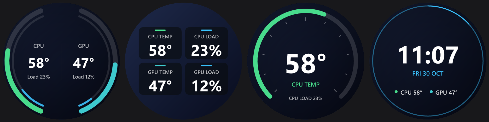

# AIO Cooler Screen

An open-source Windows app for the LCD on **Monster AIO liquid coolers** (USB HID `1D6B:0130`).
Put any image or video on the pump screen and overlay live CPU/GPU stats, without the
official app.




## Features

- **Backgrounds:** four built-in backgrounds (Nebula, Aurora, Neon rings, Sunset), or your own
  PNG/JPG/BMP/WebP images and MP4/MOV/MKV/WebM/AVI/WMV videos or animated GIFs. Crop to fill,
  fit inside, or stretch to the 480×480 screen.
- **Four stat designs:** ring gauges, dashboard tiles, one big stat, and clock + stats
  (24-hour, or 12-hour with AM/PM). Each design has its own font, text size, outline,
  colours, background dimming and design-specific options.
- **Your own designs:** start from a template, then add stat values, text, ring gauges,
  progress bars, time and date. Drag them around on the live preview and set each one's
  size, colour and stat.
- **Live sensors out of the box:** CPU temperature (AMD Ryzen and Intel Core) and load, plus
  NVIDIA GPU temperature and load, with nothing extra to install. HWiNFO or LibreHardwareMonitor
  can add more sensors. Pick any sensor for each stat.
- **Starts with Windows:** a background service drives the screen from boot, keeps it awake
  and wakes it again after sleep, with no admin prompts. You can turn this off.
- **Tray icon:** a monochrome icon that follows your Windows theme. Its menu has Open,
  Show live stats, Turn off display and Quit, and the app can start in the tray when you sign in.
- **Turn off display:** switch the pump screen off from the app's sidebar or the tray menu, and
  back on the same way. It stays off across restarts until you turn it on.
- **Windows 11 look:** light/dark mode follows Windows.

## Install

1. Download `AIO-Cooler-Screen-Setup-x.y.z.exe` from [Releases](../../releases) and run it.
   Tick **Download ffmpeg** if you want video backgrounds and don't have ffmpeg already.
   The installer isn't code-signed, so Windows may show **"Windows protected your PC"**.
   Click **More info → Run anyway**. Each release lists the installer's SHA-256 if you want
   to check the download.
2. **Close the official Monster app** (or uninstall it). Both apps would drive the screen.
3. Open **AIO Cooler Screen** from the Start menu and pick a design and a background.

Requires Windows 10/11 (64-bit).

## Sensors

| Source | What it reads | Setup |
| --- | --- | --- |
| Built in | CPU temperature: AMD Ryzen (Zen 1-5, families 17h-1Ah) via the SMN thermal register, Intel Core via the package thermal MSR. CPU load from Windows. | None. The installer adds the signed, open-source [PawnIO](https://pawnio.eu) driver if it's missing. |
| NVIDIA GPUs | Temperature and load through NVML from the NVIDIA driver. | None. |
| [HWiNFO](https://www.hwinfo.com/download/) (optional) | Everything HWiNFO sees, e.g. AMD/Intel GPUs, motherboard and drives. | Settings → enable **Shared Memory Support** and keep HWiNFO running. The free version switches this off after 12 hours. |
| [LibreHardwareMonitor](https://github.com/LibreHardwareMonitor/LibreHardwareMonitor/releases) (optional) | Everything LibreHardwareMonitor sees. | Run as administrator, then **Options → Remote Web Server → Run**. The default port is 8085; you can change it on the Device page. |

Reading CPU temperatures needs a kernel driver. PawnIO is the one LibreHardwareMonitor and
FanControl use; it works with Memory Integrity enabled. The **Live stats** page lets you choose
which reading feeds each stat; **Auto** picks the built-in CPU temperature and your discrete GPU.

## ffmpeg

Only video and GIF backgrounds need [ffmpeg](https://ffmpeg.org/). If one is on `PATH`, it's used
as is. Otherwise the installer or the app's Device page can download the
[gyan.dev release essentials build](https://www.gyan.dev/ffmpeg/builds/), check it against the
published SHA-256, and keep it private to the app in `C:\Program Files\AIO Screen\ffmpeg`.
PATH isn't changed, and uninstalling removes it.

## Build from source

Requirements: [Rust](https://rustup.rs) (MSVC toolchain) and, for the installer,
[Inno Setup 6.6 or later](https://jrsoftware.org/isdl.php).

```powershell
cargo test
cargo build --release              # target\release\aio-screen.exe
.\build-installer.ps1              # dist\AIO-Cooler-Screen-Setup-<version>.exe
```

`build-installer.ps1` downloads pinned, verified copies of the PawnIO installer and modules into
`third_party\`. To try the built-in CPU sensor from a dev build, copy `AMDFamily17.bin` or
`IntelMSR.bin` into `target\release\pawnio\`.

`aio-screen.exe` is the GUI. The installer registers it as the `AioScreen` service with
`aio-screen.exe install`. Other commands: `uninstall`, `fetch-ffmpeg`, `dump-sensors <file>`,
`make-icon <dir>`.

## How it works

The cooler is a USB HID device that takes 1024-byte reports. [`src/protocol.rs`](src/protocol.rs)
documents the protocol, which was worked out from USB traffic:

- **Text frames** carry HTTP-like commands with a JSON body, an 8-bit checksum and byte stuffing.
- **Binary frames** carry file uploads in 1000-byte blocks.
- **Connect handshake:** `POST conn`, then `POST power {"event":"resume"}`.
- **Uploads:** the background is a PNG or MP4. The stats overlay is a transparent PNG
  re-sent every second, which also keeps the screen from blanking.

| Module | What it does |
| --- | --- |
| [`device.rs`](src/device.rs) | Talks to the cooler. |
| [`overlay.rs`](src/overlay.rs) | Draws the designs (tiny-skia + ab_glyph). |
| [`cpu.rs`](src/cpu.rs) | Built-in CPU temperature (PawnIO) and load. |
| [`sensors.rs`](src/sensors.rs) | Reads NVML, HWiNFO and LibreHardwareMonitor, and combines all sources. |
| [`service.rs`](src/service.rs) | The Windows service. |
| [`gui.rs`](src/gui.rs) + [`ui/app.slint`](ui/app.slint) | The app. |

## Code signing policy

Free code signing provided by [SignPath.io](https://about.signpath.io), certificate by
[SignPath Foundation](https://signpath.org). Signing is being set up; until it's in place,
releases are unsigned.

- Only builds made from this repository by the [Release workflow](.github/workflows/release.yml)
  on GitHub Actions are signed. Each release links to the workflow run that built it.
- Committers and reviewers: [Thnorty](https://github.com/Thnorty). Changes from anyone else come
  in as pull requests and are reviewed before they're merged.
- Approvers: [Thnorty](https://github.com/Thnorty). Every signing request is approved by hand.

## Privacy

This program will not transfer any information to other networked systems unless specifically
requested by the user or the person installing or operating it.

- **ffmpeg download:** only when you tick it in the installer or click it in the app. It
  downloads the build from [gyan.dev](https://www.gyan.dev/ffmpeg/builds/) and sends nothing
  else.
- **LibreHardwareMonitor:** if you turn it on, the app reads sensors from its web server on your
  own PC (`127.0.0.1`). Nothing leaves the computer.

There's no telemetry, no update check and no account.

## Disclaimer

This is an independent project and is not affiliated with or endorsed by Monster Notebook /
Monster Bilgisayar. Product names are trademarks of their owners. It talks to your cooler
using a protocol worked out from observing USB traffic; use it at your own risk.

## License

[MIT](LICENSE). The installer also includes or downloads separately licensed components:
the PawnIO driver (GPL-2.0 with an exception) and modules (LGPL-2.1), optional ffmpeg (GPL),
and the Slint UI toolkit (royalty-free licence). See [THIRD-PARTY-NOTICES.md](THIRD-PARTY-NOTICES.md).
