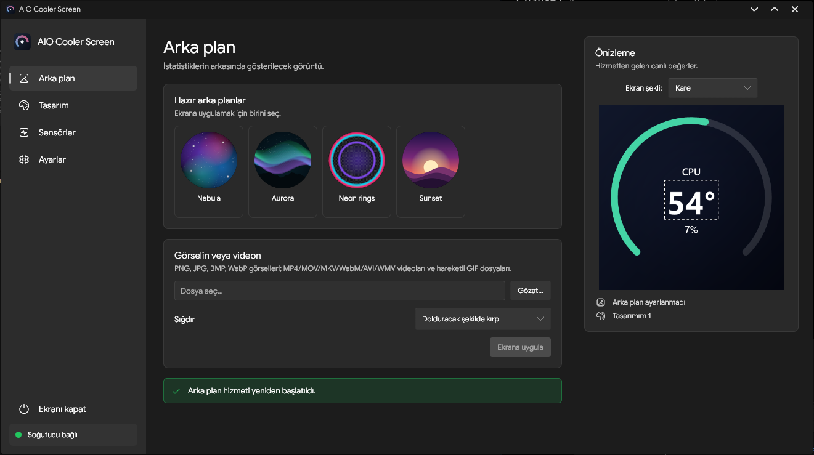
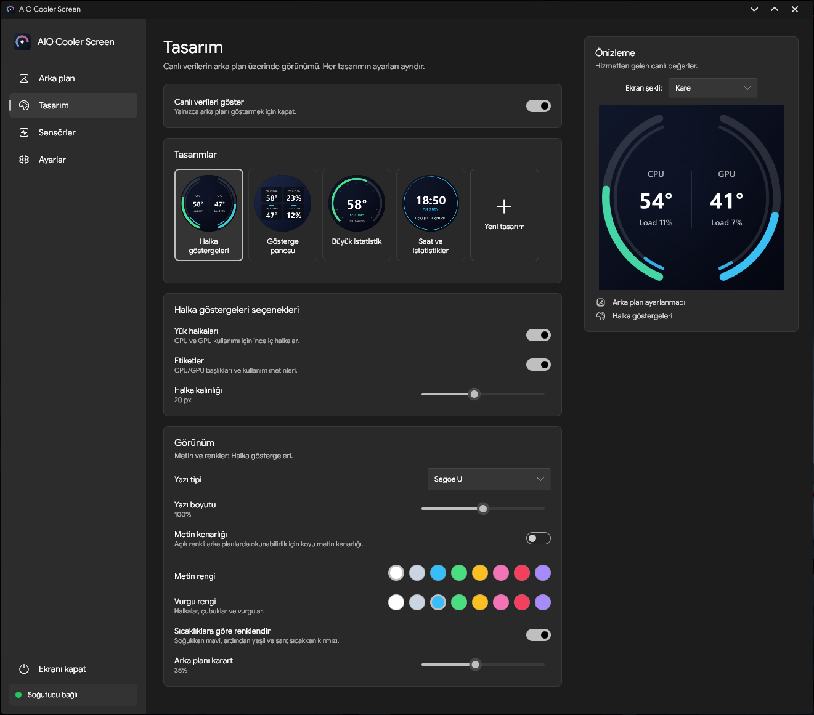
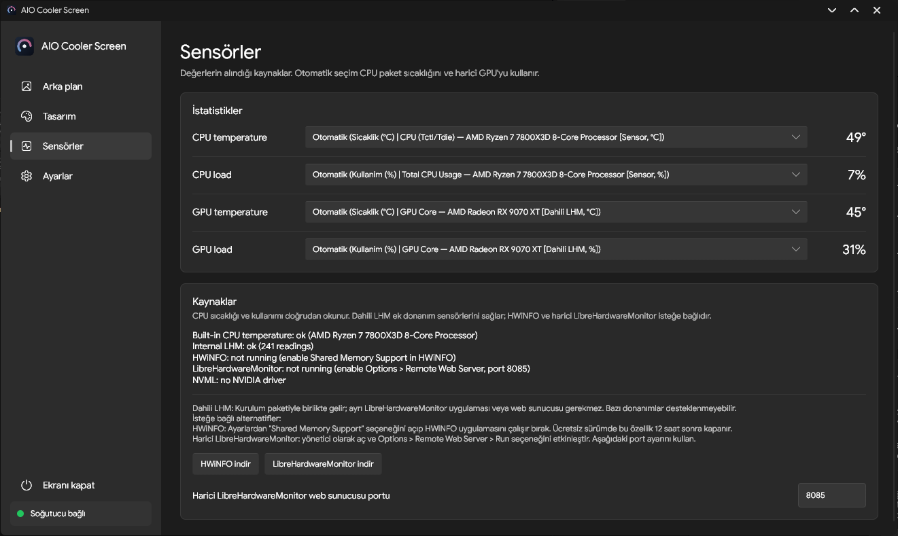
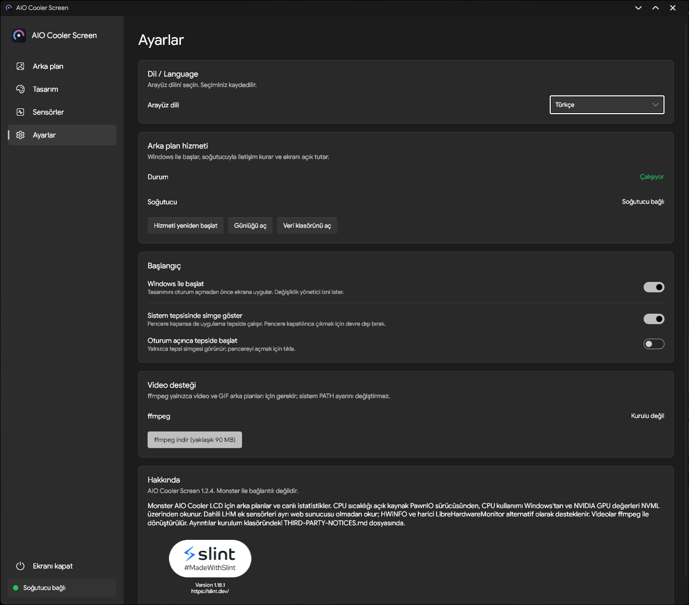

# AIO Cooler Screen — v1.2.4-Fork

[**English**](README.md) · [Orijinal proje](https://github.com/Thnorty/aio-cooler-screen) · [Sürümler](https://github.com/SefaMeert/aio-cooler-screen/releases)

Uyumlu **Monster AIO sıvı soğutucuların LCD ekranları** (USB HID `1D6B:0130`) için Windows uygulaması. [Thnorty/aio-cooler-screen](https://github.com/Thnorty/aio-cooler-screen) projesinin SefaMeert tarafından geliştirilen topluluk fork'udur; Monster ile resmî bağlantısı yoktur. Diğer markalar ve LCD protokolleriyle uyumluluk doğrulanmamıştır.

## Fork sürümünde yaptığım geliştirmeler

- **Dahili LibreHardwareMonitor:** Paketle birlikte gelen .NET 8 sensör yardımcısı sayesinde ayrı LibreHardwareMonitor uygulaması veya HTTP sunucusu çalıştırmadan desteklenen donanım sensörlerini okuma.
- **Genişletilmiş sensör bilgileri:** Donanımın desteklediği CPU frekansı, Vcore ve diğer voltajlar, anakart sensörleri, sıcaklıklar, fan ve pompa RPM değerleri arasından seçim yapabilme.
- **Otomatik donanım keşfi:** Sabit anakart modelleri veya fan numaraları kullanılmadan sensörlerin dinamik olarak algılanması; kullanıcının kendi sistemine uygun okumaları seçebilmesi.
- **Anlaşılır sensör adları:** Sensörler sekmesinde ve tasarım düzenleyicisinde teknik kimlikler yerine donanım ve sensör adlarının gösterilmesi; kayıtlı tasarımlardaki kararlı sensör anahtarlarının korunması.
- **Mevcut sensör kaynaklarının korunması:** Yerleşik CPU/GPU bilgileri, isteğe bağlı HWiNFO paylaşımlı bellek ve harici LibreHardwareMonitor HTTP desteği kullanılmaya devam eder. Harici LHM portu değiştirilebilir (varsayılan `8085`).
- **Türkçe ve İngilizce arayüz:** Uygulama, sensör ekranları, sistem tepsisi menüsü ve Windows kurulum yöneticisi için dil desteği.
- **Ek LCD yazı tipleri:** Inter, Orbitron ve JetBrains Mono dahil sekiz yeni yazı tipi ailesi; eski yazı tipi kimlikleri ve kayıtlı tasarımlar korunur.
- **Arayüz ve tasarım iyileştirmeleri:** Metin ve font görünümleri, çeviriler, yerleşim ayrıntıları ve kare LCD tasarım önizlemesi üzerinde düzenlemeler.
- **Kurulum ve Windows hizmeti iyileştirmeleri:** Güncelleme sırasında çalışan uygulama, hizmet ve sensör yardımcısının yönetilmesi; iki dilli kurulum ekranları.

Sensörlerin kullanılabilirliği ve gereken erişim izinleri donanıma göre değişir. Fan/pompa RPM değerini okumak, fan hızını **kontrol etmek** anlamına gelmez. Ayrıntılar için [sensör rehberine](SENSOR-GUIDE.md) bakabilirsiniz.

## Orijinal uygulamadan gelen özellikler

- **480 × 480 LCD arka planları:** Nebula, Aurora, Neon Rings ve Sunset adlı dört hazır arka plan; ayrıca PNG, JPG, BMP, WebP, animasyonlu GIF ve MP4, MOV, MKV, WebM gibi video dosyaları. Doldur, sığdır ve esnet seçenekleri.
- **Dört hazır istatistik tasarımı:** Halka göstergeler, gösterge paneli kartları, tek büyük istatistik ve saat + istatistik düzeni; renk, font, boyut, kenarlık ve arka plan karartma ayarları.
- **Özel tasarım düzenleyicisi:** Metin, sensör değerleri, halka göstergeler, ilerleme çubukları, saat ve tarih bileşenlerini canlı önizlemede yerleştirme ve özelleştirme.
- **Canlı CPU/GPU bilgileri:** Yerleşik CPU sıcaklığı ve yük ölçümü, NVML üzerinden NVIDIA GPU sıcaklığı ve yük ölçümü ve isteğe bağlı ek sensör kaynakları.
- **Arka planda Windows hizmeti:** Bilgisayar açıldığında LCD'yi yönetme, ekranı aktif tutma ve uyku sonrasında yeniden bağlantı kurma; otomatik başlatma davranışını ayarlayabilme.
- **Sistem tepsisi kontrolleri:** Uygulamayı açma, canlı istatistikleri gösterme, ekranı kapatma ve çıkış; Windows temasına uyumlu simge.
- **Ekranı açma/kapatma:** Uygulama veya sistem tepsisinden LCD'yi kapatıp açma; kapalı tercihini yeniden başlatmalarda koruma.
- **Windows görünümüne uyum:** Sistem temasını takip eden açık/koyu görünüm.
- **İsteğe bağlı FFmpeg:** Video ve animasyonlu arka plan desteği; sistemin `PATH` ayarını değiştirmeden uygulama üzerinden yüklenebilir.

## Ekran Görüntüleri

### Arka Plan

### Tasarım

### Sensörler

### Ayarlar

## Kurulum

1. **Windows 10/11 x64** için [Sürümler](https://github.com/SefaMeert/aio-cooler-screen/releases/tag/v1.2.4-Fork) sayfasından **`AIO-Cooler-Screen-Setup-1.2.4-Fork.exe`** dosyasını indirip çalıştırın. Kurulumda Türkçe veya İngilizce seçebilirsiniz. Tam paket Windows hizmetini, dahili sensör yardımcısını ve ek LCD yazı tiplerini içerir.
2. USB bağlantısında çakışmayı önlemek için AIO Cooler Screen'i kullanmadan önce Monster'ın orijinal LCD yazılımını kapatın.
3. Uygulamayı açın, arka plan ve tasarım seçin; ardından Sensörler bölümünden istediğiniz değerleri belirleyin. Video ve animasyonlu arka planlar için isteğe bağlı FFmpeg gerekebilir.

Ayrı indirilebilen `aio-screen.exe` ileri düzey kullanım içindir ve **tam kurulum paketindeki bütün bileşenleri içermez**.

**Smart App Control bilgilendirmesi:** Bu sürüm dijital olarak imzalanmamıştır. Windows 11'in Smart App Control (Akıllı Uygulama Denetimi) özelliği, testlerde gözlemlendiği gibi bazı bilgisayarlarda uygulamayı engelleyebilir; bu durum özelliğin açık olduğu her bilgisayarda sorun yaşanacağı anlamına gelmez. Smart App Control'ü açık tutmak veya devre dışı bırakmak kullanıcının kendi tercihidir. Dijital imzalama için çözüm araştırılmaktadır.

## Ayrıntılı belgeler

[Donanım sensörleri rehberi](SENSOR-GUIDE.md) · [Derleme ve kurulum paketi](FORK-BUILD-README.md) · [Ek yazı tipleri](FONT-README.md) · [Üçüncü taraf lisansları](THIRD-PARTY-NOTICES.md)

Orijinal MIT lisansı [LICENSE](LICENSE) dosyasında korunmaktadır. Paketteki LibreHardwareMonitor bileşeninin ayrı MPL-2.0 yükümlülükleri üçüncü taraf bildirimlerinde açıklanmıştır.
